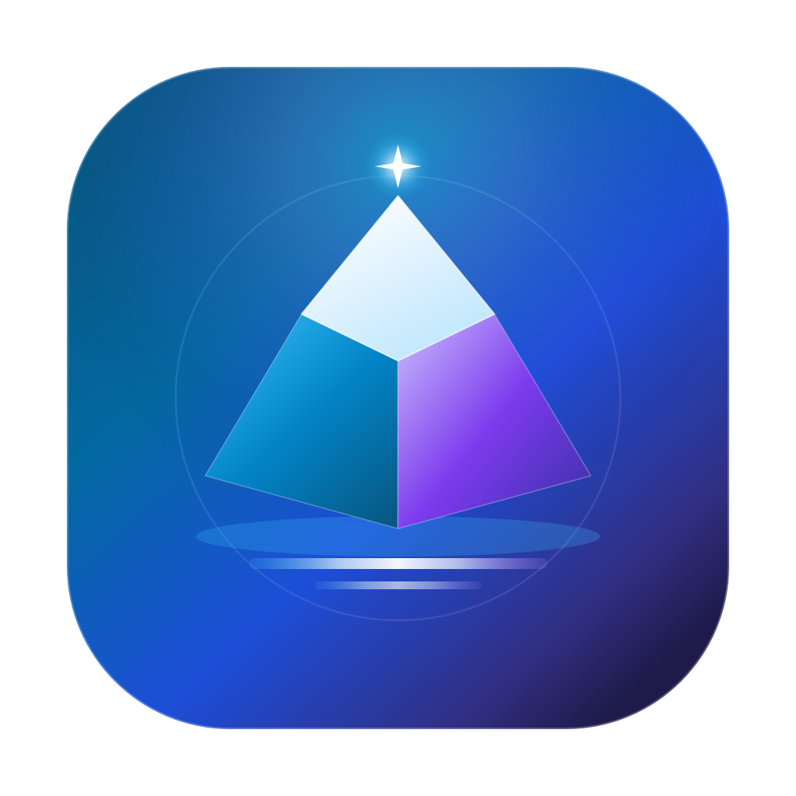

<div align="center">



# LightIsle · 轻屿

**把 Apple Silicon Mac 变成轻量、私有的家庭 NAS。**

原生 Mac 管理 · Web / PWA · Android / iOS / macOS

[快速开始](#快速开始) · [功能](#功能一览) · [架构](#技术架构) · [开发](#开发与构建) · [文档](docs/INDEX.md)

</div>

> [!IMPORTANT]
> **Beta 开发预览，尚未正式发布。** 代码和自动化测试不等于真实硬盘、手机和长期运行验收。请勿将唯一重要数据存放于开发版；应用配置备份**不包括**照片、视频和文件原件。

## 为什么是 LightIsle？

不重装 macOS，不自建 RAID、文件系统或 Docker 引擎。让 Mac 负责硬件与本机安全操作，让家庭成员通过统一客户端使用 NAS。

## 功能一览

| 模块 | 能力 |
| --- | --- |
| **文件与分享** | 浏览、搜索、批量操作、分片续传、回收站、分享链接、WebDAV |
| **照片与影音** | 相册与时间线、照片地图、电影/剧集、字幕、播放进度、按需转码 |
| **多硬盘与成员** | 按物理盘管理存储根；个人文件/照片/视频分类放置；成员每盘独立额度 |
| **连接与任务** | 默认局域网访问；可选 Cloudflare Tunnel、FRP、下载、通知与本地脚本 |
| **Mac 系统管理** | 外接盘状态、Docker Desktop/Colima 管理、监控与应用配置备份 |
| **多端使用** | Web/PWA；Flutter Android、iOS、macOS 客户端 |

**当前边界：** 多盘额度按 `rootID + generation` 独立，普通成员每盘默认 **100 GiB**，同盘三类文件共用。**写入渠道尚未全部纳入硬配额**（API 为 `enforcement=pending`），不能当作已完成的强制限额。Android 后台照片、实盘拔插、音视频兼容与远程访问仍需真机验收。详见 [功能状态](docs/STATUS.md)。

## 技术架构

| 组成 | 技术 | 职责 |
| --- | --- | --- |
| Mac 管理端 | SwiftUI / AppKit | 首次初始化、服务生命周期、本机高权限操作 |
| NAS Core | Go / SQLite | 登录授权、存储根、文件/媒体/任务 API |
| Web / PWA | Vue 3 / TypeScript | 浏览器用户端 |
| 移动及桌面客户端 | Flutter | Android / iOS / macOS 访问已有 NAS |

**主机仅支持 Apple Silicon Mac + macOS 14+**。关闭主窗口可继续在菜单栏运行，明确退出 App 会停止 Core；Flutter 客户端**不是**额外的 NAS 服务端。

## 快速开始

源码构建还需要 **Go 1.26+、Xcode/Swift 6、Node.js/npm**。FFmpeg、aria2、Docker、cloudflared 和 FRP 都是可选依赖。

```bash
git clone https://github.com/lengsukq/LightIsle.git
cd LightIsle
bash scripts/build-macos.sh
open dist/LightIsle.app
```

1. 在 **Mac 原生 App** 首次创建管理员，选择安全、可写的 NAS 专用存储目录。
2. 本机浏览器打开 `http://127.0.0.1:16666/`；如有修改，请使用 Mac App 显示的实际地址。
3. 初始化后默认允许可信家庭局域网 HTTP 访问；需要时在 Mac App 中启用 HTTPS 或配置可选的远程连接。

> [!CAUTION]
> **不要将明文 HTTP 管理端口直接映射到公网。** 使用 HTTPS/安全隧道，并核对客户端证书或连接配置。LightIsle 的每周五份自动备份仅覆盖应用配置和 SQLite；原始数据请单独使用 Time Machine 或其他独立备份介质。

## 开发与构建

```bash
go test -race ./...
go vet ./...
bash scripts/verify-macos.sh

cd apps/flutter
flutter pub get
flutter analyze
flutter test
```

`build-macos.sh` 生成本地 Ad-hoc 签名 App/DMG，不等同于 Apple Developer ID 签名或公证。手动 GitHub Actions 构建与 Android 签名要求见 [开发指南](docs/DEVELOPMENT.md)、[正式发布门禁](docs/PRODUCTION_RELEASE.md)。

```text
apps/macos/    SwiftUI 管理端及原生媒体 Worker
apps/web/      Vue 3 Web/PWA
apps/flutter/  Flutter 客户端
core/          Go Core 与 SQLite
scripts/       构建、测试、发布辅助脚本
docs/          使用、安全、架构与验收规范
```

## 文档与进度

[文档总览](docs/INDEX.md) · [产品边界](docs/PRODUCT.md) · [当前能力](docs/STATUS.md) · [路线图](docs/ROADMAP.md) · [存储与磁盘](docs/STORAGE_AND_DISKS.md) · [Flutter](docs/FLUTTER_CLIENT.md) · [架构](docs/ARCHITECTURE.md) · [安全](docs/SECURITY.md)

## 许可证

[MIT License](LICENSE)。外部工具各自遵循其许可证。
