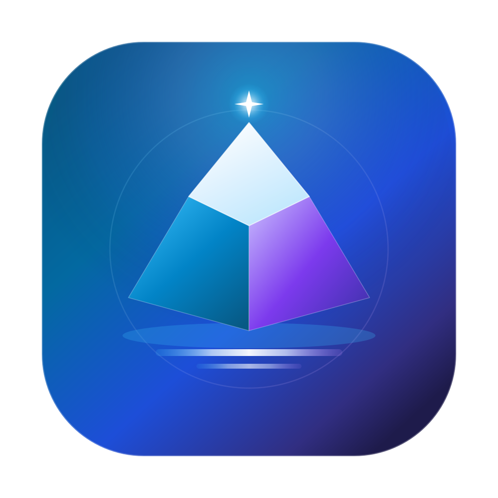

# 轻屿 LightIsle



> **运行在 Apple Silicon Mac 上的个人/家庭 NAS 管理层。** 不替换 macOS，不自建 RAID/存储池，复用 APFS、系统 SMB、FSEvents、Time Machine 和 SQLite，以一个原生 App 提供文件、照片、影视与远程访问。

**项目状态：开发预览，尚未达到正式发布标准。** 现有代码、自动化测试和本机临时签名构建都不等于 USB 外置硬盘故障测试、Android/iOS 真机或 Developer ID 公证成功。需要重要数据托管时务必留独立备份。

**文档唯一入口：[docs/INDEX.md](docs/INDEX.md)** · [当前功能与缺口](docs/STATUS.md) · [快速上手与构建](#构建与运行) · [正式发布门禁](docs/PRODUCTION_RELEASE.md)

## 它如何工作

一个 `LightIsle.app` 就是一个 NAS 进程生命周期的拥有者。启动 Mac App 后启动内置 Go Core；**关闭主窗口仍可留在菜单栏继续提供服务，明确退出（⌘Q/菜单栏退出）才会停止 NAS**。不会安装独立常驻的 macOS 系统守护进程。可选登录项与防空闲休眠仍需在实际设备上验证。

| 端 | 技术和职责 |
| --- | --- |
| **Mac 原生管理端** | SwiftUI + AppKit；初始管理员、存储授权、外置磁盘、安全备份与恢复、服务/网络开关、Docker 可选管理 |
| **Core** | Go + SQLite；账号和成员授权、文件、图库/影视、受限分享/任务、HTTP API、根目录物理身份保护 |
| **Web/PWA** | Vue 3；文件管理、图库、影视、日常账号、系统资源及管理员功能 |
| **Flutter 用户端** | Android、macOS、iOS 的文件/媒体/账号客户端，连接 NAS 而不管理 NAS 宿主的危险系统操作 |

后端仅构建和支持 **macOS arm64（Apple Silicon）**；不支持 Linux、Windows 或 Intel Mac 作为服务端。Docker Desktop/Colima 不是运行 NAS 的前提，LightIsle 也不会自动安装它们。详情见 [架构](docs/ARCHITECTURE.md) 与 [原生 App 生命周期](docs/MACOS_APP.md)。

## 主要能力（代码开发版）

- **文件**：Web/Flutter 目录浏览与排序、搜索、文件与文件夹操作、分块上传/断点续传、Range 下载、上传冲突反馈、回收站/恢复、限期密码/次数控制的单文件分享、有限 ZIP 导出。
- **图库**：照片/视频索引与时间线、相册/私人相册、账户收藏、HEIC/视频缩略图和增量扫描。部分大图库、Live Photo 动态配对及跨端展示仍待完善。
- **影院**：电影/剧集、手工 NFO/TMDB/豆瓣候选、原片 Range、字幕/续播、可选 FFmpeg/HLS 按需转码。实际可播放格式受设备解码器与 FFmpeg 安装影响。
- **多账号及数据安全**：由 Mac 原生初始化管理员，其他账户由管理员创建，SQLite + Argon2id；普通用户默认只访问授权目录，管理员密码可在 Mac 使用本机所有者身份验证重置。
- **存储与磁盘**：外接盘容量、挂载/格式、只读及 SMART 基础状态；管理员可在安全条件下改名/挂载/弹出。未知健康状态不得显示为健康。NTFS 通常只读；格式化仅由用户在 macOS「磁盘工具」中执行。
- **备份/恢复**：Mac 本机可备份已授权共享文件和应用 SQLite 数据，隔离提取、验证后离线恢复；支持有界任务/定时备份。**不能替代 Time Machine 或离线异盘备份，更不是企业级联合事务恢复。**
- **远程访问与运维**：管理员手动开启 LAN HTTPS、可选 WebDAV 独立凭据及 Cloudflare Tunnel、本机 Docker/Colima 管理、资源历史、低空间与任务失败告警。公网证书、域名和真实客户端仍需实际验收。
- **移动端媒体备份**：Android/iOS 前台照片原片；可显式开启原始视频和 iOS Live Photo 配套 MOV；Android WorkManager 后台仅备份照片。超限和未下载的 iCloud 资源不能视为已完成。
- **多共享目录**：v2 按 rootID/generation 区分文件/ACL/媒体/任务，额外根具备只在开发预览启用的自动索引补扫。旧数据与授权迁移、逐根自动备份尚未闭环，所以**正式多根入口仍默认禁用**。

详细到“用户入口 → API/权限 → 持久化 → 错误及恢复”的完成情况，请只看 [当前功能状态](docs/STATUS.md)，不要用旧 Beta 的完成比例判断发布进度。产品优先级和“明确不做”的内容见 [个人版 fnOS 对标](docs/FNOS_PARITY_PRIORITIES.md)。

## 构建与运行

需要 Apple Silicon Mac、Go 1.26+、Xcode/Swift 工具链、Node.js 与 npm；最低 macOS 版本和 Apple 开发者证书仍需发布前验证。

```bash
git clone https://github.com/lengsukq/LightIsle.git
cd LightIsle
bash scripts/build-macos.sh
open dist/LightIsle.app
```

本地 Mac App 默认 Web 地址为 `http://127.0.0.1:16666/`（可从 Mac 设置修改端口并重新启动）。首次使用从 Mac App 创建管理员；Web **只提供登录**，不允许匿名初始化管理账号。

**忘记管理员密码？** 在 Mac App「设置 → 管理员安全 → 重置管理员密码」，通过 macOS 的密码或 Touch ID 验证 Mac 所有者身份；随后在同页查看实际首任管理员用户名，再用新密码重新登录 Web。该操作撤销旧管理员会话，不删除 `accounts.sqlite` 或重新初始化用户。

**接入外接硬盘？** 在 Mac App「数据与存储」查看当前 NAS 目录和磁盘，选择可写外接卷内的专用目录。切换存储位置**不会自动移动原文件或继承旧盘授权**；断开硬盘时保留原绑定等待用户恢复。只读 NTFS、清理离线盘记录和格式化的注意事项见 [存储与外接盘指南](docs/STORAGE_AND_DISKS.md)。

**远程访问？** 先在 Mac 端手动开启，确认网络和 HTTPS/证书的来源。WebDAV 使用独立密码，Cloudflare Token 放在 Mac 钥匙串；详见 [远程访问](docs/REMOTE_ACCESS.md)。不要通过公开端口直接暴露本地管理 IPC。

## 代码与质量验证

```bash
go test -race ./...
go vet ./...
bash scripts/verify-macos.sh
```

Web 独立运行与测试请查看 [开发指南](docs/DEVELOPMENT.md)；Flutter 运行请查看 [Flutter 客户端](docs/FLUTTER_CLIENT.md)。构建脚本得到的是**本地开发用临时签名 App**，并非已公证、可分发的生产包。真机外置盘、SQLite 独立恢复、移动设备、系统休眠、规模/72 小时和正式 Developer ID 签名/公证仍需依 [发布门禁](docs/PRODUCTION_RELEASE.md) 验收。

## 文档

- [文档总索引：使用、开发、架构、存储、备份、网络和安全](docs/INDEX.md)
- [当前功能/闭环状态、剩余 P0/P1 和回归证据](docs/STATUS.md)
- [开发路线与个人版范围取舍](docs/ROADMAP.md)
- [正式生产发布安全门禁](docs/PRODUCTION_RELEASE.md)
- [历史 Beta/P0/P1 文档摘要及 Git 追溯方法](docs/HISTORY.md)

源码 MIT 开源；品牌和最终系统兼容范围以未来发布说明为准。
