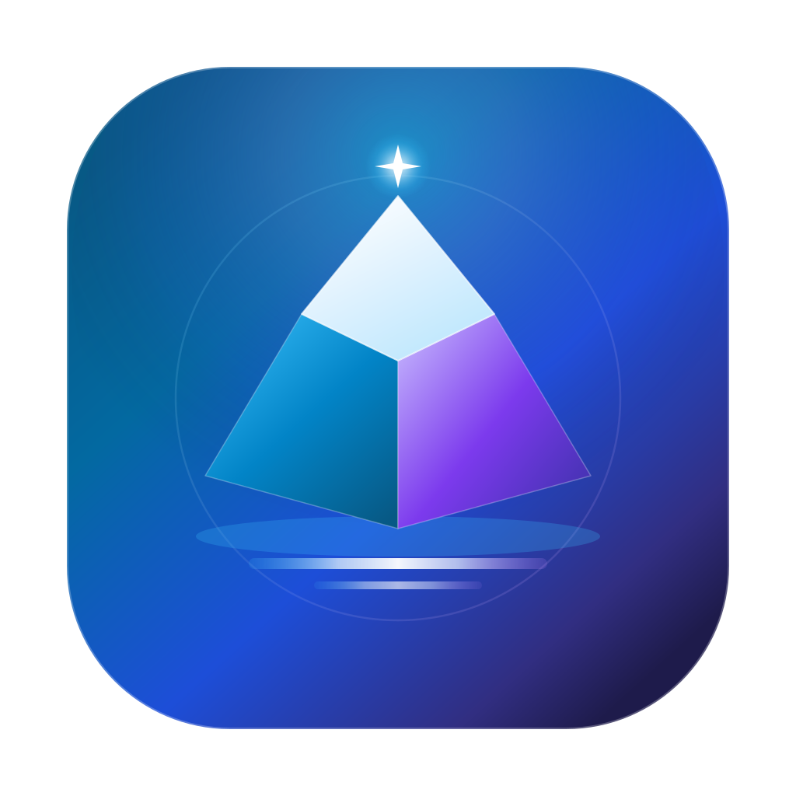

# LightIsle · 轻屿

**Turn your idle Mac into a gentle sanctuary for your family's memories.**

*A lightweight, elegant, and powerful private home NAS crafted for Apple Silicon.*

Native macOS App · Modern Web / PWA · Cross-Platform Mobile & Tablet Apps

[English](README_EN.md) · [简体中文](README.md)

[Why LightIsle](#why-choose-lightisle) · [Capabilities](#features--capabilities-at-a-glance) · [Getting Started](#begin-your-lightisle-journey) · [Developer Guide](docs/DEVELOPMENT.md) · [Docs Center](docs/INDEX.md) · [License](#license--commercial-terms)

---

> [!IMPORTANT]
> **Beta Developer Preview Notice**: LightIsle is actively evolving with on-device hardware validations. Please do not store unique, irreplaceable data as your sole copy during testing. LightIsle's configuration backup is dedicated to system settings and photo metadata; your original photos, videos, and files remain safely in place on your own physical disks.

---

## Why Choose LightIsle?

In many homes, a quiet Mac mini sits plugged into the wall—whispering with untold computational power, yet spending most of its days simply idling on a desk. At the same time, you may have long dreamed of creating a private, safe haven for your family's treasured photos, home videos, and essential documents.

Perhaps you were captivated by the refreshing user experience of modern home NAS platforms like **fnOS (飞牛私有云)** or **JiKongJian (极空间)**, or contemplated investing in costly dedicated hardware from **Synology (群晖)** or **QNAP (威联通)**—or even wrestled with DIY bootloaders like **Xpenology (黑群晖)**. Yet, you were likely held back by steep price tags, noisy fan hums, obscure Linux terminal commands, and the daunting demand to reformat your existing hard drives. And like many of us, you have grown weary of commercial cloud storage with its subscription fees, aggressive photo compression, speed throttling, and privacy doubts.

**Your Mac was born to be the heart of your home.**  
With industry-leading energy efficiency, powerful dedicated media engines, and whisper-quiet operation, why sacrifice the macOS you love just to run a NAS?

**LightIsle was born from this exact realization.**  
We bring the intuitive, family-first experience inspired by fnOS and Synology DSM right into macOS—**without asking you to abandon your operating system, and without locking you into a monolithic box**. LightIsle is a lightweight companion that understands your Mac and cherishes your family. Simply open the app, and give every member of your family their own personal sanctuary in the clouds.

---

### ✨ Thoughtfully Crafted Experiences

#### 🌿 Keep Your macOS, Zero Friction, In-Place Freedom
- **Say goodbye to flashing and bootloader hacks**: No need to purchase specialized NAS hardware or flash Linux distributions. LightIsle runs as a native macOS application. Your Mac mini remains your favorite desktop computer, development workstation, or media player.
- **Inspired by fnOS & Synology, yet designed for Mac**: Bringing the polished experience of modern NAS systems—timelines, cinema posters, shared drives, and user quotas—while preserving Apple's signature hardware-software elegance.
- **Respect your existing storage**: No forced reformatting or complex RAID migrations. Plug in any external hard drive or multi-bay enclosure; grant directory access, and LightIsle recognizes your files in place while keeping your Finder habits intact.

#### 📸 Family Timelines · Preserving Every Heartbeat
- **Original quality, lossless backup**: Gather photos scattered across all family phones into one secure haven. Enjoy uncompressed, full-resolution storage and say goodbye to "Storage Full" phone alerts.
- **Intelligent timelines & footprint maps**: Baby's first steps, summer vacations, and quiet family dinners unfold gracefully across time and space. An interface so clean and intuitive that even grandparents and children can browse with ease.

#### 🎬 A Cozy Private Cinema · Lighting Up Weekend Nights
- **Artful poster walls automatically scraped**: Automatically matches high-resolution movie covers, cast details, and plot summaries—turning messy filenames into a curated private film collection.
- **Unleash Apple Silicon silicon engines**: Harness M-series hardware video decoders and encoders for instant 4K playback, smooth scrubbing, on-demand transcoding, and synchronized multi-language subtitles across TVs, tablets, and phones.

#### 🏡 Intimate yet Private · Space for Everyone
- **Dedicated personal spaces**: Create independent accounts for each family member. Personal photo albums and private documents are strictly isolated to protect individual privacy.
- **Warm shared library**: Family travel albums, common movie collections, and household records can be placed into the shared space with a single click—upload once, enjoy together.
- **Clear & flexible storage quotas**: Set per-disk usage quotas for family members to prevent a single user from filling up a drive, offering quiet peace of mind.

#### 🧩 A Thriving Mini-App Ecosystem · Your Handcrafted Digital Isle
- **Free yourself from Docker memory bloat and port chaos**: Running Docker on macOS demands 1–2.5 GB of RAM just for the Linux VM; leaving low-frequency tools running 24/7 constantly drains system resources. LightIsle introduces a **lightweight three-state lifecycle**: pure static pages cost **0 MB**, and dynamic backends stay asleep at **0 MB**, waking up in milliseconds when accessed and sleeping automatically when idle.
- **Write in any language**: Python, Node.js, Go, Rust, Java, or pure HTML—turn any lightweight script into an embedded private mini-app without cumbersome containers.
- **Single sign-on & granular member permissions**: No need to memorize obscure port numbers like `:8080` or `:3000`. Grant access to the whole family, keep tools admin-only, or share with specific members seamlessly from mobile apps or the Web workspace.
- **Native AI Agent integration (Built-in MCP Server)**: Connect your favorite AI coding assistant (Cursor, Claude Code, etc.) via Model Context Protocol. Simply say, *"Build a broadband monitor plugin for my family,"* and watch your AI scaffold, write, and hot-reload the app directly into LightIsle.

#### 🌐 Everywhere You Go, Always Together
- **Refined multi-platform experience**: Crafted in accordance with Apple Human Interface Guidelines across modern Web/PWA, native macOS management, and lightweight iOS and Android apps.
- **Gigabit local speed & secure tunnels**: Enjoy lightning-fast local network transfers at home. When you're away, connect seamlessly via encrypted tunnels (such as Cloudflare Tunnel or FRP) to access family memories on the go.

#### 🛡️ Data in Your Hands · Unconditional Peace of Mind
- **No surveillance, no compression**: All files remain entirely on your own physical disks, free from commercial cloud scanning and speed caps.
- **Physical disk identification & safety guards**: Precise identification of physical hardware prevents accidental overwrites or data loss. If an external drive disconnects, LightIsle provides clear, reassuring recovery guidance rather than performing dangerous background migrations.

---

## Features & Capabilities at a Glance

| Category | Highlights | Experience |
| :--- | :--- | :--- |
| **Family Photos** | Smart Timeline · Footprint Map · Lossless Backup | Seamless phone sync, fluid high-res zooming, memories brought back to life |
| **Private Cinema** | Film Poster Wall · Auto Subtitles · Cross-Device Progress | Apple Silicon hardware acceleration, instant 4K streaming, smooth playback |
| **Mini-Apps & Plugins** | 0 MB On-Demand Wake · Multi-Language · AI MCP Integration | Freedom from Docker overhead, Python/Node/Go extensibility, member-level ACLs |
| **Files & Sharing** | Instant Search · Resumable Chunked Upload · WebDAV | Drag-and-drop large file uploads, shareable links, in-place file coexistence |
| **Multi-Disk Storage** | Physical Identity · Personal Homes · Elastic Quotas | Multi-bay external drive support, privacy preserved, shared library harmony |
| **Mac System Guard** | Disk Health · Menu Bar Resident · Auto Config Backup | Silent and energy-efficient; 5 weekly automated application configuration backups |
| **Unified Ecosystem** | Native macOS Manager · Modern Web/PWA · Mobile Apps | Thoughtfully tailored for all generations in the family |

> For current technical implementation and ongoing milestones, see [Status (STATUS.md)](docs/STATUS.md).

---

## Begin Your LightIsle Journey

Turn your Mac into a family private cloud in three simple steps:

1. **Launch the App**: Open LightIsle on an Apple Silicon Mac (M1 / M2 / M3 / M4 or newer) running macOS 14 Sonoma or later.
2. **Initial Setup**: Follow the native Mac assistant to create an administrator account and select the native directories or external hard drives you wish to use.
3. **Connect Your Family**: Visit the local address from any browser on the same Wi-Fi network (default `http://127.0.0.1:16666/` or the LAN address shown in the Mac App), or scan to connect via mobile apps to begin enjoying your private cloud.

> [!CAUTION]
> **Security Reminder**: LightIsle is designed primarily for trusted local family networks. If you require remote access outside your home, please configure HTTPS or utilize secure encrypted tunneling. Never expose unencrypted HTTP management ports directly to the public internet.

---

## Deep Dive & Technical Documentation

To keep this welcome guide clean, warm, and focused, technical engineering details, build commands, and API specifications have been curated into dedicated documentation:

- 🛠️ **Developer Guide & Building from Source**: Build from source, run test suites, or contribute code? Read the [Developer Guide (DEVELOPMENT.md)](docs/DEVELOPMENT.md).
- 🧩 **Mini-App & Plugin Architecture**: Design lightweight home tools, 0 MB on-demand services, or connect AI Agents? Read the [Plugin Architecture (PLUGIN_ARCHITECTURE.md)](docs/PLUGIN_ARCHITECTURE.md).
- 📐 **System Architecture**: Discover process boundaries between Go Core, SwiftUI, and multi-platform clients: read [Architecture (ARCHITECTURE.md)](docs/ARCHITECTURE.md).
- 🧭 **Product Principles & Boundaries**: Learn about our philosophy and architectural trade-offs: read [Product Principles (PRODUCT.md)](docs/PRODUCT.md).
- 📚 **Full Documentation Index**: For multi-disk mechanics, security specifications, Flutter clients, and network tunnels, visit the [Documentation Center (INDEX.md)](docs/INDEX.md).

---

## License & Commercial Terms

LightIsle is a **source-available** personal NAS project. To allow individuals and families to enjoy a clean, high-quality private cloud free from commercial exploitation, our own codebase is provided under the **[PolyForm Noncommercial License 1.0.0](LICENSE)** (SPDX: `PolyForm-Noncommercial-1.0.0`):

- **Free for Personal and Family Non-Commercial Use**: You and your family are warmly welcomed to inspect, run, modify, and share the code in everyday personal life.
- **Commercial Use Requires Prior Written Authorization**: For enterprise deployment, commercial hosting, commercial redistribution, or hardware pre-installation, please review our [Commercial Terms (COMMERCIAL.md)](COMMERCIAL.md) and obtain a commercial agreement.
- **Earlier MIT Versions Unaffected**: The license change applies starting from releases containing the new license; historical versions lawfully acquired under MIT retain their original rights.
- **Independent Third-Party Licenses**: External open-source dependencies and tools retain their respective licenses, detailed in [Third-Party Notices](THIRD_PARTY_NOTICES.md).

We warmly invite you to read our [Contributing Guidelines](CONTRIBUTING.md). Let us build this gentle island together.

*May technology be as gentle as spring rain, quietly safeguarding every irreplaceable moment for you and your loved ones.*

