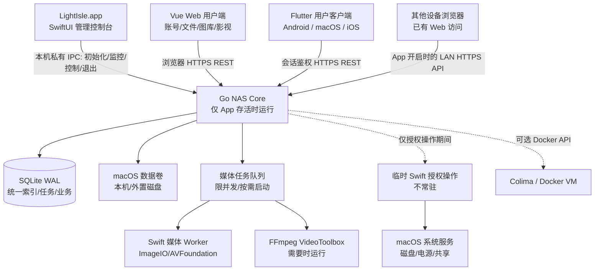

# 技术架构与模块边界

> **唯一后端目标：macOS arm64 / Apple Silicon。** 不为 Linux、Windows、x86_64 编写服务端兼容层。服务端由 Mac 原生管理端拥有，用户客户端包括 Vue Web/PWA 与 Flutter Android、macOS、iOS；**不做独立常驻 NAS 守护进程**。具体实现和安全验收状态以 [STATUS](STATUS.md) 为准。

## 1. 架构与边界

- **LightIsle.app**：唯一生命周期拥有者。SwiftUI/AppKit 负责原生首次管理员初始化、系统指标、服务及存储控制台，不内嵌文件/图库/影视用户页面。打开 App 启动 Go，完全退出 App 停止 Go。
- **Go Core**：由 App 启动的普通权限子进程；负责 API、认证/授权、文件访问、统一索引、图库、影视、任务调度、审计、进程监控。**不安装独立 launchd 服务**。
- **Swift Worker**：优先用于 Swift/macOS Framework 的媒体与系统 API；不把大量业务逻辑写在 Swift。
- **Swift 特权操作**：用户授权时才运行受限、临时的辅助操作，不能作为持续运行的高权限守护服务。普通 API 不等于 root 权限。
- **Vue Web**：桌面、平板和 Android 浏览器的用户界面，负责账号登录、文件、图库、影视和账户管理。尚未初始化时只提示用户到 Mac 操作，HTTP 禁止创建首任管理员。
- **其他设备浏览器与 Flutter**：共享受限 REST/HTTPS 业务契约；Flutter Android、macOS、iOS 为独立用户客户端，不拥有本机管理员/磁盘操作特权。
- **共享设计系统**：Mac 与 Web 以 iOS 27 / macOS 27 的 Liquid Glass 层级为视觉目标，设计 token 作为语义单一来源。Mac 用系统 SwiftUI 材质；Web 映射实现，并保留各自输入规范。参见 [DESIGN_SYSTEM.md](DESIGN_SYSTEM.md)。
- **SQLite**：小型本地数据库。原始媒体始终存储在用户指定的目录，不进数据库。
- **容器服务**：Colima/Docker 作为可选模块，停用或缺失时不能影响核心 NAS。

### App 生命周期是业务约束

- **关闭最后一个主窗口或最小化窗口**，Mac App 仍留在菜单栏，Go Core 与 NAS 服务继续运行；这是产品现行契约。
- **明确执行 ⌘Q / 菜单栏退出**才关闭 Core API、LightIsle 媒体任务及 App 自己启动的子进程。Android 只有 Mac App 正在运行且用户开启远程访问时才能连接。
- 即使 App 崩溃，也必须使用父进程管道 EOF 与 PID/心跳监督防止 Go Core 变成孤儿常驻进程。
- App 没有运行时，不自动开机启动服务器、不保证注销或未登录时远程访问。
- 外部 Docker/Colima 容器是用户独立运行的第三方服务，LightIsle 退出**不自动停止**它们。

具体关闭顺序、错误恢复与真机验收见 [macOS App 生命周期](MACOS_APP.md)。

## 2. 实际仓库结构与数据归属

| 目录/模块 | 现有职责 |
| --- | --- |
| `apps/macos` 与 `Package.swift` | SwiftUI/AppKit 宿主管理端、私有控制 IPC、ImageIO/AVFoundation 媒体 Worker |
| `core/cmd/lightisled` | Go Core 入口、原生私有命令处理、备份/扫描任务调度 |
| `core/internal/server`、`auth`、`files` | HTTP 路由、会话和按根授权、受保护的文件/上传/分享/回收站操作 |
| `core/internal/roots`、`storageidentity`、`diskmgmt` | 共享根身份（rootID、generation、目录/卷 Binding）、可租用的物理句柄、管理员磁盘操作保护 |
| `core/internal/gallery`、`cinema`、`mediaworker` | 图库/影视 SQLite 派生索引、媒体任务、Swift Worker 交互及可选 ffmpeg |
| `core/internal/backup`、`tasks` | 文件/SQLite 快照、隔离恢复、任务和告警持久记录 |
| `apps/web`、`apps/flutter` | Vue Web/PWA 与 Flutter Android、macOS、iOS 用户客户端 |
| `scripts`、`tests`、`docs/adr` | 构建/回归/发行门禁、历史架构决策 |

以上是**当前可查看的代码目录**，不再列出未创建的 `native/macos-arm64`、`core/migrations`、`contracts/openapi.yaml`、`packaging/macos-arm64` 作为已存在模块。详细运行/测试见 [DEVELOPMENT](DEVELOPMENT.md)。

## 3. 数据模型与物理身份

- 应用持久化依赖多个有职责边界的 SQLite WAL 数据库（账号/任务/图库/影视等），不是计划中的单一“全量 file_entries 目录索引”或跨数据库联合事务；建表/升级方式以各实际包为准。
- **原始照片、影片及文件始终保存在用户授权卷目录**，SQLite 只记录可重建的媒体索引及不可再生的用户数据（账号/授权、私人相册、收藏、观看进度和手工匹配元数据）。后者必须有可验证的独立备份和恢复流程。
- 初版单根 API 继续保留；隔离的 v2 多根按 `rootID + generation + 物理 Binding` 租用文件管理器、索引/任务与文件分享。**另一硬盘或同路径新 inode 绝不能重用旧根的成员授权**；无身份确认时根是离线，不根据路径“猜测重连”。
- 外置卷 FSEvents 事件可能丢失或合并，需通过有界周期对账补扫；索引可重建不代表文件已备份。

## 4. 文件生命周期

1. 管理员注册**明确允许访问的数据根目录**，服务端解析符号链接与卷边界，阻断路径穿越。
2. 首次后台扫描建立索引；FSEvents 增量更新，但事件可能合并/丢失，须有定期对账。
3. 文件变化异步投递图库与影视派生索引；任务去重、限频；离线卷只标记 unavailable。
4. 目录改名/移动更新关系并防止 TOCTOU 问题；跨卷移动采用复制-校验-原子确认而非错误假设 rename 原子。
5. 文件回收站不同于“从媒体库移除”；自动清理策略需可配置并明确占用空间。

## 5. 图库架构

- 读取 EXIF、方向、时间及 HEIC/AVIF 的真实平台支持能力。
- Swift Media Worker 优先调用 ImageIO/QuickLookThumbnailing，统一按尺寸和版本生成缩略图。
- 缩略图落磁盘缓存，可设置容量、LRU/年龄清理，不把原图完整载入常驻服务。
- Web 时间线 cursor 分页 + 虚拟滚动；分区/相册与通用文件列表复用 file_id。
- 人脸识别、AI 分类先不加入核心，未来只做可卸载/禁用任务模块。

## 6. 影视与播放策略

播放协商三层策略：**Direct Play → Direct Stream/Remux（如确有必要）→ Transcode**。

- Web/Android 上报解码及容器支持能力，不仅根据文件扩展名猜测。
- HTTP Range 流式返回文件；支持鉴权和读取边界，不缓存整个媒体。
- 字幕、音轨、HDR、HEVC 的具体兼容性需要矩阵化真机测试。
- 视频处理使用 macOS 宿主机进程和 VideoToolbox；不期待 Linux Docker VM 使用 Mac GPU 转码。
- 转码工作队列设置并发、超时、资源限额、断连回收、临时目录空间上限。
- 第三方影视元数据与海报抓取属可选增强，有速率限制、失效缓存与手工纠正入口。

## 7. macOS-only 约束与运维

- Go 构建目标为 `GOOS=darwin GOARCH=arm64`；Mac 原生 App 是 Core 唯一生命周期所有者，关闭窗口仍提供菜单栏 NAS，⌘Q/明确退出停止服务。父进程 EOF/终止处理必须防止孤儿 Core 和媒体任务。
- 文件、SMART/磁盘、Time Machine、SMB 及系统安全验证均优先采用 macOS 系统能力或有严格白名单的程序；高权限 SMART 请求由 Mac 用户手动授权，不在 HTTP 暴露任意 shell、系统盘格式化或系统权限绕过。
- Docker/Colima 是**用户预先安装的可选引擎**。LightIsle 可按需管理但不捆绑、不在启动时依赖 VM，退出不关闭用户已有容器。
- FileVault、无用户登录、网络证书、系统休眠与外接盘真实安全行为必须分别真机验收；**不承诺 Mac 关机后仅靠软件能提供 NAS**。

## 8. 当前 API 与客户端约定

- 现行单根 REST 采用 `/api/v1/...`，隔离多根试验路由为 `/api/v2/roots/{rootID}/...` 且默认未向用户正式开放。旧客户端不通过新 v2 接口猜测权限。
- 请求使用已认证会话并按操作检查管理员身份或成员授权；文件/分享/媒体访问每次校验真实根目录身份和访问范围。Mac 物理文件夹选择、离线恢复与宿主系统命令只使用私有 IPC。
- 分页、分块上传、Range 下载与任务取消/重试以实际 handler 为准；错误目前常用 `{"error":"code"}`，**没有宣称存在的 OpenAPI 自动 SDK 或统一四字段错误 JSON**。
- 音视频播放实现细节与缓存等参数详见下方/独立的 [影音实施技术记录](CORE_LOOP_PLAN_2026-10-25.md)；正式播放能力受浏览器解码、ffmpeg 安装及真实设备测试限制。

详见 [Mac 应用生命周期](MACOS_APP.md)、[跨端设计系统](DESIGN_SYSTEM.md)、[安全](SECURITY.md)、[性能](PERFORMANCE.md)、[开发指南](DEVELOPMENT.md)。

