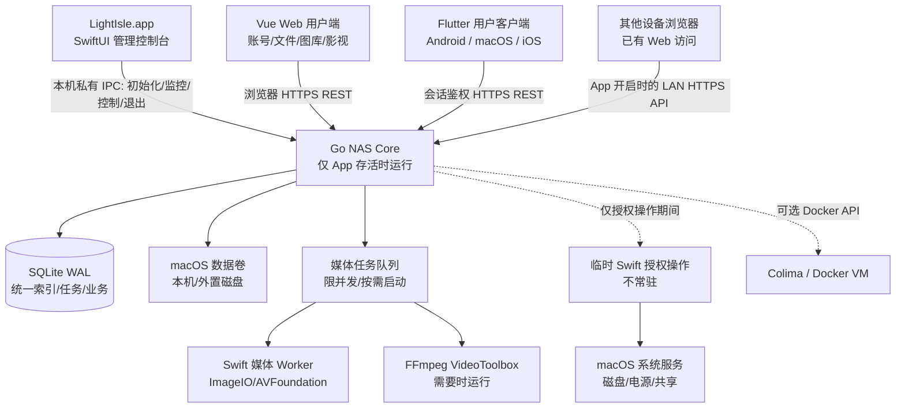

# 技术架构与模块边界

> **唯一后端目标：macOS arm64 / Apple Silicon。** 不为 Linux、Windows、x86_64 编写服务端兼容层。服务端由 Mac 原生管理端拥有，用户客户端包括 Vue Web/PWA 与 Flutter Android、macOS、iOS；**不做独立常驻 NAS 守护进程**。具体实现和安全验收状态以 [STATUS](STATUS.md) 为准。

## 1. 架构与边界



- **LightIsle.app**：唯一生命周期拥有者。SwiftUI/AppKit 负责原生首次管理员初始化、系统指标、服务及存储控制台，不内嵌文件/图库/影视用户页面。打开 App 启动 Go，完全退出 App 停止 Go。
- **Go Core**：由 App 启动的普通权限子进程；负责 API、认证/授权、文件访问、统一索引、图库、影视、任务调度、审计、进程监控。**不安装独立 launchd 服务**。
- **Swift Worker**：优先用于 Swift/macOS Framework 的媒体与系统 API；不把大量业务逻辑写在 Swift。
- **Swift 特权操作**：用户授权时才运行受限、临时的辅助操作，不能作为持续运行的高权限守护服务。普通 API 不等于 root 权限。
- **Vue Web**：桌面、平板和 Android 浏览器的用户界面，负责账号登录、文件、图库、影视和账户管理。尚未初始化时只提示用户到 Mac 操作，HTTP 禁止创建首任管理员。
- **其他设备浏览器与 Flutter**：共享受限 REST/HTTPS 业务契约；Flutter Android、macOS、iOS 为独立用户客户端，不拥有本机管理员/磁盘操作特权。
- **共享设计系统**：Mac 与 Web 以 iOS 27 / macOS 27 的 Liquid Glass 层级为视觉目标，设计 token 作为语义单一来源。Mac 用系统 SwiftUI 材质；Web 映射实现，并保留各自输入规范。参见 [DESIGN_SYSTEM.md](DESIGN_SYSTEM.md)。
- **SQLite**：小型本地数据库。原始媒体始终存储在用户指定的目录，不进数据库。
- **容器服务**：Colima/Docker 作为可选模块，停用或缺失时不能影响核心 NAS。

### App 生命周期是业务约束

- **关闭最后一个主窗口或最小化窗口**，Mac App 仍留在菜单栏，Go Core 与 NAS 服务继续运行；这是产品现行契约。
- **明确执行 ⌘Q / 菜单栏退出**才关闭 Core API、LightIsle 媒体任务及 App 自己启动的子进程。Android 只有 Mac App 正在运行且用户开启远程访问时才能连接。
- 即使 App 崩溃，也必须使用父进程管道 EOF 与 PID/心跳监督防止 Go Core 变成孤儿常驻进程。
- App 没有运行时，不自动开机启动服务器、不保证注销或未登录时远程访问。
- 外部 Docker/Colima 容器是用户独立运行的第三方服务，LightIsle 退出**不自动停止**它们。

具体关闭顺序、错误恢复与真机验收见 [macOS App 生命周期](MACOS_APP.md)。

## 2. 代码组织建议

```text
lightisle/
├── README.md
├── apps/
│   ├── macos/                # SwiftUI / AppKit 主应用（App 生命周期所有者）
│   ├── web/                  # Vue + TypeScript + PWA
│   └── flutter/              # Flutter 用户客户端（Android/macOS/iOS）
├── core/
│   ├── cmd/lightisled/       # Go 启动入口
│   ├── internal/
│   │   ├── api/              # HTTP 路由 / API middleware
│   │   ├── auth/             # 密码、会话、权限、设备
│   │   ├── system/           # 系统指标、服务状态
│   │   ├── storage/          # macOS 磁盘数据及安全挂载
│   │   ├── files/            # 安全路径、CRUD、传输、回收站
│   │   ├── indexer/          # 文件事件、索引与对账
│   │   ├── photos/           # 图库业务索引
│   │   ├── cinema/           # 影视业务与播放
│   │   ├── tasks/            # 任务队列、重试、取消
│   │   ├── backup/           # 备份恢复
│   │   ├── containers/       # 可选 Docker 模块
│   │   └── audit/            # 管理员操作审计
│   └── migrations/
├── native/
│   └── macos-arm64/
│       ├── media-worker/     # 图片/视频系统能力桥接
│       ├── privileged-helper/# 临时、受控的特权操作
│       └── installer/        # macOS 单一 App 打包与签名
├── contracts/
│   └── openapi.yaml          # Web API 协议
├── packaging/
│   └── macos-arm64/
├── tests/
├── benchmarks/
└── docs/
```

这里的目录是**目标结构**，不表示代码已经存在。不要建立空目录只为满足架构图。

## 3. 数据模型

建议按以下实体建立 SQLite migration：

- `storage_volumes`：卷稳定身份、名称、挂载点、可用性、文件系统。
- `file_entries`：卷身份、标准化相对路径、父记录、类型、大小、mtime、文件 ID（可用时）、状态。
- `media_assets`：引用文件记录、媒体类型、EXIF/宽高/时长、缩略图与处理状态。
- `photo_albums` / `album_members` / `favorites`：相册和收藏（不能仅靠扫描恢复）。
- `media_titles` / `media_episodes` / `playback_progress`：影视实体、剧集、观看状态。
- `tasks` / `task_attempts`：可中断、重试、故障恢复的任务运行数据。
- `users` / `sessions` / `devices` / `audit_events`：安全与审计。

文件路径可以变化，**卷身份 + 持久的文件标识（可得时）+ 可校验的路径回退**优于只用绝对路径作为永久主键；不要使用相对路径绕开授权根目录。SQLite 使用 WAL，单写者模型，长事务应避免阻塞 API。

## 4. 文件生命周期

1. 管理员注册**明确允许访问的数据根目录**，服务端解析符号链接与卷边界，阻断路径穿越。
2. 首次后台扫描建立索引；FSEvents 增量更新，但事件可能合并/丢失，须有定期对账。
3. 文件变化异步投递图库与影视派生索引；任务去重、限频；离线卷只标记 unavailable。
4. 目录改名/移动更新关系并防止 TOCTOU 问题；跨卷移动采用复制-校验-原子确认而非错误假设 rename 原子。
5. 文件回收站不同于“从媒体库移除”；自动清理策略需可配置并明确占用空间。

## 5. 图库架构

- 读取 EXIF、方向、时间及 HEIC/AVIF 的真实平台支持能力。
- Swift Media Worker 优先调用 ImageIO/QuickLookThumbnailing，统一按尺寸和版本生成缩略图。
- 缩略图落磁盘缓存，可设置容量、LRU/年龄清理，不把原图完整载入常驻服务。
- Web 时间线 cursor 分页 + 虚拟滚动；分区/相册与通用文件列表复用 file_id。
- 人脸识别、AI 分类先不加入核心，未来只做可卸载/禁用任务模块。

## 6. 影视与播放策略

播放协商三层策略：**Direct Play → Direct Stream/Remux（如确有必要）→ Transcode**。

- Web/Android 上报解码及容器支持能力，不仅根据文件扩展名猜测。
- HTTP Range 流式返回文件；支持鉴权和读取边界，不缓存整个媒体。
- 字幕、音轨、HDR、HEVC 的具体兼容性需要矩阵化真机测试。
- 视频处理使用 macOS 宿主机进程和 VideoToolbox；不期待 Linux Docker VM 使用 Mac GPU 转码。
- 转码工作队列设置并发、超时、资源限额、断连回收、临时目录空间上限。
- 第三方影视元数据与海报抓取属可选增强，有速率限制、失效缓存与手工纠正入口。

## 7. macOS-only 约束与运维

- Go 构建目标固定 `GOOS=darwin`、`GOARCH=arm64`；Swift/Xcode 目标为 macOS arm64。
- Go Core 由 SwiftUI Mac App 以子进程形式运行，不能作为 LaunchAgent/LaunchDaemon 单独常驻；关闭 App 会关闭其子进程。通过 IPC + 心跳监控异常退出。
- Swift Helper 使用受限操作定义、请求身份校验及本地 socket/XPC；安装授权在真实 Apple Silicon 上验证。
- 磁盘信息/电源/SMB 使用 macOS 原生 API 或受控系统工具，不把 Linux 命令当后备方案。
- Docker 插件显式探测 Colima/Docker 状态；禁止启动路径强依赖 VM。
- 保留 macOS 的数据保护与系统盘限制；FileVault、无人值守重启需测试。
- App 内原生设置和故障排查应在 Go Core 崩溃时仍可使用；Web UI 由 App 内嵌 WKWebView 复用。

## 8. API 约定

- 路径以 `/api/v1` 开始；请求/响应版本化；OpenAPI 是契约来源。
- 分页统一 cursor + limit；文件上传遵循可续传协议，下载支持 Range。
- 异步操作返回 task ID，客户端订阅事件或轮询进度。
- 错误结构统一为 code、message、request_id、details（details 不泄露路径与凭证）。
- 危险操作须重新验证身份、审批令牌、明确对象和审计记录；禁止通用 Shell HTTP API。

详见 [Mac 应用生命周期](MACOS_APP.md)、[跨端设计系统](DESIGN_SYSTEM.md)、[安全](SECURITY.md)、[性能](PERFORMANCE.md)、[开发指南](DEVELOPMENT.md)。

