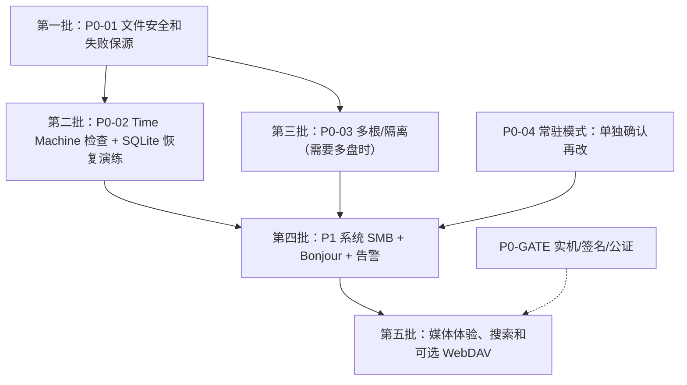

# 对标 fnOS：macOS 原生能力优先的个人 NAS 规划

> **2026-10-25 代码现状更新：** [个人 / 极客用户对标及源码差距审查](PERSONAS_AND_CODE_AUDIT_2026-10-25.md)。本文继续定义产品边界；该新文档负责区分已存在代码、未提交开发增量、真机验收债与后置事项。目前文件排序/同名冲突已出现 Go 后端开发代码，但三端体验未闭环；影视 HLS/剧集/刮削亦是开发代码，不能直接标为正式完成。
>
> **2026-10-25 晚间补充**：上述开发增量（排序/冲突、转码/剧集/刮削、SMART 历史、回收站清理、分享密码）已全部提交至 main 并通过全量自动化验证（Go/Swift/Web/Flutter）；web 端排序与冲突 UI 已闭环，Flutter 端补齐上传冲突策略、PDF/HEIC 预览与分享标签（排序 UI 原已存在）。剩余缺口收敛为 [真机验收债清单](ACCEPTANCE_DEBT_2026-10-25.md)，需真实设备/外部服务证据，不阻塞代码合并。

> **2026-10-23 最新产品决定**：LightIsle 是运行在 **macOS arm64 上的个人/家庭 NAS 管理层**，不是第二套 NAS 操作系统，更不是企业级存储平台。**优先复用 macOS/APFS/SMB/Time Machine/Spotlight/FSEvents/SQLite，先做好文件、照片、影视、网络访问和日常维护。** 不把自研文件+数据库联合灾难恢复、复杂跨盘事务引擎、自建增量备份系统纳入个人版开发承诺。
>
> 本文是**最新产品范围和优先级**，取代此前此文件中的 P0 联合灾备、目录级事务化移动与自研备份依赖图；它**不表示代码已改好或已通过验收**。[2026-10-23 功能复审](REAUDIT_AND_EXECUTION_2026-10-23.md)、[P0/P1 交付记录](P0_P1_DELIVERY_2026-10-23.md) 与 [旧 19 项复核](FUNCTION_GAP_AUDIT_2026-10-23.md) 属于工程/历史状态快照，不能反向覆盖本产品决策。
>
> **范围**：Mac SwiftUI 管理端 + Go Core + Vue Web，后端仅 macOS arm64。现有 Flutter Android/iOS/macOS 客户端保留；Android 照片备份已进入当前个人版开发范围，系统后台执行仍须真机验收。LightIsle.app 仍拥有 Go Core 生命周期，**完全退出 App 就停 NAS**；不内置 Docker 引擎、镜像或独立常驻服务。

## 1. 原则：哪些交给系统，哪些保留在 LightIsle

| 能力 | 优先采用的 macOS / 现有机制 | LightIsle 仍需承担的事情 |
| --- | --- | --- |
| 文件新建、复制、移动、重命名、删除 | APFS/POSIX 文件操作；Swift 原生界面按需使用 FileManager、NSOpenPanel；Go 当前文件操作**已经调用 macOS 文件系统**，无须为“原生”全部重写 | Web/Flutter API、只允许授权根、账号权限与撤销、不覆盖、失败时保留源数据、进度和反馈 |
| 同卷快速复制 / 重命名 | 在兼容的 APFS 卷上可用 clonefile/copyfile clone；同卷 rename 原子操作（需检查错误和覆盖策略） | 克隆失败回退普通复制；不得直接重命名跨卷对象；上传分片、Range 下载是应用协议逻辑 |
| 搜索、变化监听、媒体解析 | FSEvents、Spotlight（可选）、ImageIO、Quick Look、AVFoundation、VideoToolbox | 多用户授权过滤，非索引卷/被禁用 Spotlight 时降级；缩略图和索引缓存可重建 |
| 局域网文件共享 | macOS 系统 SMB；系统设置管理共享账户与权限 | 共享状态检测和安全引导。**系统 SMB 账号/ACL 不自动等于 LightIsle 的用户/目录授权**；不直接自动开放整个根目录 |
| 原始文件与系统备份 | Time Machine（选择合适的独立备份盘）、APFS 支持时的本地快照/加密 | 提示未配置/备份失败/数据卷未覆盖；为应用私有数据库另外保留可验证的导出/恢复 |
| SQLite 应用业务数据 | SQLite WAL/事务、官方一致性备份方式（如 Online Backup API，或现有一致性快照实现） | 备份账号、授权、私人相册/收藏、手工元数据；恢复前校验并在停止服务时显式恢复，失败保留旧副本 |
| 多盘共享与远程访问 | DiskArbitration/卷身份、Bonjour、系统网络、用户自行安装的 Tailscale/EasyTier/cloudflared | 根/卷安全身份、按根授权、远程认证与日志；不自研穿透协议（可选管理本机已装 cloudflared，见 P1-08） |

**重要边界**：

1. **macOS 原生机制不会自动代替 NAS 权限**：Go 使用系统调用同样是在复用 macOS；不必强制把底层 Go 改写为 Swift。macOS 文件系统只能保证操作层面的性质，不知道 LightIsle 哪个成员可读哪个目录。
2. **Time Machine 不是自动兜底**：必须由用户开启、指定备份目标，并**确认真正的数据所在外置卷已经纳入备份**；一些卷可能被排除、未连接或不受支持。数据盘与备份目标须物理分离。APFS 本地快照不是异盘备份；数据盘故障也可能丢失同盘快照。
3. **SQLite WAL 不等于自动业务恢复**：不要直接复制运行中的 .sqlite 主文件当一致性备份；使用 SQLite 正规备份/停服务校验流程。Time Machine 恢复文件与独立恢复数据库可能来自不同时间点，**不保证跨卷跨库同时点一致**。LightIsle 应能重扫可再生索引、提示失效引用、保留手工分类/账号数据的独立备份。
4. **非 APFS 外置盘**（例如 exFAT）没有相同的快照/克隆/元数据语义；检测文件系统能力后降级，绝不假定所有卷具备 APFS 特性。应用虚拟回收站可继续保留，不能把 Finder 废纸篓语义直接套到 Web 多用户。
5. **安全不是企业级功能**：不覆盖、权限校验、防止路径穿越和错误磁盘重挂、可靠上传、崩溃后保源以及恢复旧数据库属于个人版基础要求；复杂跨盘 ACID/两阶段提交/全自动灾备编排则不是。

## 2. 当前工作区状态（不等于已发布）

> 最新 Beta 3 再审和本轮优先闭环见 [Beta 3 缺口复审](BETA3_REAUDIT_2026-10-23.md)，Beta 基础范围见 [个人 Beta 范围](BETA_SCOPE_2026-10-23.md)。后续多根代码增量见 [多目录与恢复预览续做记录](MULTI_ROOT_RECOVERY_PROGRESS_2026-10-23.md)：已接隔离 API、Web/原生开发预览和逐根备份，默认仍关闭；旧数据迁移与真机验收未闭环，因此下表的“尚未贯通”仍指正式用户可用范围。

| 模块 | 已有开发版能力 | 个人版需要补齐 |
| --- | --- | --- |
| 文件 | Go 文件 API、分页、分片续传、Range、回收站、分享、同卷操作、跨卷安全复制与单文件安全移动 | 更好的原生文件操作路径、APFS clone 可选加速、失败清理与可理解提示；不强制完成目录事务化跨卷移动 |
| 多盘 | 物理卷身份采集与单根共享；[多根 ADR 0002](adr/0002-multiple-share-roots.md) 已定义契约 | 多根路由、每根账号授权、卷离线和重挂安全、Web/媒体/备份隔离；**当前尚未贯通** |
| 备份 | 全量文件 + 一致性 SQLite 快照、校验、离线恢复/元数据回退开发版 | 原生 Time Machine 设置/覆盖提示；轻量应用元数据备份与真实恢复演练。**不要求自动联合恢复引擎** |
| App 在线 | SwiftUI 管 Go 子进程，关闭窗口继续菜单栏服务，显式退出停止 Core | 菜单栏、可选登录项和防空闲休眠代码已接入，待真实关窗/注销/睡眠验收；**不承诺 FileVault 解锁前/用户未登录就继续提供服务** |
| 接入 | LAN HTTPS、Web、Flutter 预览；Mac 上 SMB 端口诊断 | 系统 SMB 引导、Bonjour、可选 WebDAV 和可信的私有组网 |
| 图库/影视 | 时光轴、私人/共享相册和收藏、缩略图、NFO/TMDB 手动匹配、直放、字幕、续播 | 大图库稳定性、格式兼容、轻量转封装/必要时硬件转码，按需 OCR/智能能力 |
| 运维 | 持久告警/审计、Docker/Colima 本地管理初版 | macOS 通知/备份失败告警与实机验证；Docker 不成为核心依赖 |
| 发布 | 本机测试/打包和 QA 门禁脚本 | Developer ID/公证/干净机器及发布门禁真实通过；产品降级**不会自动修改现有 QA 脚本** |

## 3. 最新优先级

P0 = 个人 NAS 的必要安全与可用性；P1 = 高价值常用能力；P2 = 按需增强；“**不做**”不等于下一期排队。工作量 S/M/L 表示相对复杂程度，不承诺天数。**先保证数据不丢与权限不串，再关注使用体验；不把企业级极端一致性当作所有功能的依赖。**

### P0：个人版必须有的基础

| 编号 | 任务 | 完成条件 / 不做的过度设计 |
| --- | --- | --- |
| **P0-01** | **安全文件操作与系统复用** | 保留现有 Go+macOS 系统调用、安全根、账号授权、原子发布/不覆盖和已完成单文件安全移动；普通文件操作优先系统 API，APFS clone 属可选优化。跨卷优先提供**复制**，如提供移动则须先复制校验、出错保留源文件，并明确恢复方式；**不要求目录级事务引擎、通用持久化跨盘队列或自动删源** |
| **P0-02** | **基础备份兜底与轻量数据库恢复** | 在 Mac 端引导并核实 Time Machine 是否启用、目标磁盘与实际 NAS 数据卷覆盖情况（不能仅凭 TM 开关宣称有备份）；保持已实现的一致性 SQLite 元数据备份/哈希校验、隔离恢复、所有者确认、旧数据库保留和手工重扫。至少验证一次真实**账号/授权/私人相册元数据恢复**。无可靠异盘备份时明确警告，**不自研“文件+SQLite 同一事务切换”** |
| **P0-03** | **多根目录与按根授权（登记/ACL 底座已有代码，未贯通业务）** | 已加入持久 rootID/卷身份/租约和隔离的 root_file_grants；仍须按 [ADR 0002](adr/0002-multiple-share-roots.md) 完成文件/图库/影视/分享/上传/备份按根路由与授权，未贯通前**不开放多根用户入口**。不把离线卷误判为文件删除，不开发 RAID/存储池/冗余层 |
| **P0-04** | **常驻使用体验（代码已接入，待真机）** | 已改关闭窗口留菜单栏、显式退出停 NAS；已接可选 `SMAppService.mainApp` 登录项和 Core 在线时防空闲休眠。尚须真正关窗/菜单栏/注销/睡眠唤醒 GUI 验收；不新增后台守护服务、不承诺断电后无人登录恢复 |
| **P0-GATE** | **发布安全门禁（并行）** | 保留真实文件/数据库恢复、外接盘故障与权限、GUI/Android LAN HTTPS、升级、签名和公证校验。**不再把自动联合灾备/目录事务移动当作个人版产品发布功能前提**。但现有 [发布 QA 脚本](../scripts/verify-release-qa.py) 的真实硬件、5 GiB/10 GiB/72 小时等检查项仍会执行，本轮**只改文档，未更改脚本门禁** |

**说明**：P0-03 针对计划公开提供多个共享根的版本；若先发布单根个人版，可以保持单根契约并明确功能限制，但不能对外开放仅部分实现的多根选择。

### P1：优先做高频、低维护成本能力

| 编号 | 任务 | 最小可交付范围 |
| --- | --- | --- |
| **P1-01** | **macOS SMB + Time Machine 引导（部分代码已接入）** | 已有 SMB TCP 状态/系统设置入口和权限警示；新增 Time Machine 目标、元数据/共享目录排除状态的只读检查及系统设置入口。尚须系统实机验证与详细配置引导；macOS SMB/Time Machine 不与 LightIsle 用户 ACL 自动合并；“本机向外备份”和“作为其他 Mac 的备份目的地”是**两种不同功能** |
| **P1-02** | **WebDAV（已实现，待真机验收）** | 已按本节约束实现：独立可撤销凭证（每用户最多 8 条、服务端生成、仅显示一次、只存摘要）、逐请求目录授权（与 Web 同一套 grants）、`/dav/` 前缀挂在本地与 LAN HTTPS 监听器、MemLS 锁、DELETE 入应用回收站、Basic 认证失败限流；不复用 Web Cookie 和 `X-LightIsle-Request` 头。Web 设置页与 Flutter 设置页提供密码自服务。Finder/Windows/Infuse 真机挂载与读写验收仍待做 |
| **P1-03** | **Bonjour + 私有组网引导（部分代码已接入）** | macOS 已接 `_lightisle._tcp` 广播，HTTPS 关闭或 Core 停止后撤销；已加入 Tailscale/EasyTier 官方配置说明和证书检查提示，但未替用户安装或配置 VPN；Flutter 自动发现、连接变化与真实网络证书验证仍待做 |
| **P1-08** | **Cloudflare Tunnel 管理（已实现，待真机验收）** | Core 监督本机已装的 `cloudflared`（仅 Homebrew 白名单路径，不捆绑不下载），免费快速隧道（trycloudflare 随机域名）与 API Key 模式（用户自有账号：创建/删除命名隧道、一键绑定公共主机名 = DNS CNAME + 远程 Ingress，读改写避免覆盖他人规则）两种模式；开关与 Token 管理只在 Mac App，API Token 存 Keychain 并在 Core 重启后经私有 IPC 重发，Core 仅内存持有；意外断开进入持久告警并有限退避重启；与用户已有的其他 cloudflared 实例互不干扰。真机验收（含代理环境 argotunnel 放行）仍待做 |
| **P1-04** | **图库和影院日常体验** | 稳定分页、增量索引、HEIC/视频体验、真实素材测试；影视直放优先，不兼容时先考虑外部播放器/转封装，必要时再引入 VideoToolbox/FFmpeg 🔌。**2026-10-25 增补**：转封装/硬件转码（Homebrew ffmpeg 白名单 → fMP4 HLS）、内嵌字幕抽取、音轨切换、剧集聚合与 TMDB 自动刮削已进入开发版（见 [CORE_LOOP_PLAN](CORE_LOOP_PLAN_2026-10-25.md)），待真机验收；未安装 FFmpeg 时诚实降级为直放/下载 |
| **P1-05** | **原生通知与运维（主体代码已接入，待全量告警和系统验证）** | 已接 Mac 通知授权开关、Core 异常、备份操作失败、共享根离线、磁盘低于 5 GiB/5% 通知；新增私有 IPC 每分钟只读同步已持久化的图库/影视扫描失败等告警，按状态和类别去重；升级失败提醒、扩展告警及真实通知到达仍待做 |
| **P1-06** | **搜索（单根 Spotlight 可选实现已接入）** | `/api/v1/files/search?engine=spotlight` 在授权子树内使用受限 macOS 索引查询，结果二次认证；Web 有开关，未索引时回退文件名遍历。多根 rootID 范围、真实外接磁盘和搜索索引性能尚未验收，不自行复刻系统全文检索平台 |
| **P1-07** | **数据库恢复易用性** | 已有离线元数据恢复安全路径保留；更清晰的确认、检查、恢复预览、数据库迁移/回退及文件重扫入口。可重建缩略图/媒体索引与不可重建账号/私人相册明确区分 |

### P2：可选增强，不为追求 fnOS 功能数量而必做

| 编号 | 项目 | 原则 |
| --- | --- | --- |
| **P2-01** | Flutter 后台相册自动备份 | Android 已进入 Beta 3 当前开发，前台与系统后台任务应分别验收；iOS 后台调度无固定时刻保证，不能用 WebDAV 代替自动备份证明 |
| **P2-02** | OCR、场景识别、重复照片 | 优先 Vision 本地 API；明确准确率、语言和设备限制，不强制引入外部模型 |
| **P2-03** | 人物聚类、自然语言搜图 | 如确实使用再评估 Core ML/外部模型 🔌、许可证与隐私 |
| **P2-04** | Live Photo / RAW 更完整支持 | 根据系统 ImageIO 等能力和真实机型逐项兼容 |
| **P2-05** | APFS clonefile 优化 | 检测同卷 APFS 能力、失败普通复制回退；不承诺所有格式磁盘支持 |
| **P2-06** | DLNA、下载中心 | 用现有客户端/系统能力可替代时先不做；下载中心须资源有界、SSRF 保护 |
| **P2-07** | Docker 应用模板 | 仍只管理已有引擎，不内置镜像/安装器 |
| **P2-08** | UPS、受权关机/重启 | 可读状态优先，不在 Web 暴露任意特权命令 |
| **P2-09** | 文件夹/相册分享、云端同步 | 用户确有需求才扩展；仍需授权、过期/撤权，不静默上传。**2026-10-25 增补**：单文件分享的密码保护与下载次数上限已进入开发版（argon2 摘要、公共端点限流、原子计数），文件夹/相册分享仍后置 |
| **P2-10** | 额外备份工具接入 | 可选引导用户自行安装和配置 restic/rclone 🔌；**不自研第二套增量备份引擎** |

### 明确不进入个人版范围

- **自研联合灾难恢复系统**：不实现文件+多 SQLite+多卷的跨资源事务性快照、自动联合激活与联合回滚；原始文件仍以用户的数据盘及其独立备份为准。LightIsle 可重建派生索引，但需保护不能重新生成的账号、授权、私人相册/收藏。
- **企业级跨盘事务与迁移调度**：不以两阶段提交、跨卷“完全原子移动”、故障后自动删除源目录、大规模持久化 IO 调度器为个人版交付目标；原有单文件安全移动可以保留使用，未经验证的新目录移动宁可不开放。
- **自建文件系统/备份平台**：不造 RAID/Btrfs/ZFS、文件版本系统、跨盘去重/块级增量引擎、企业审计/配额/LDAP/多租户审批或自研内网穿透。
- 不把 Docker、外部 AI 模型、完整视频转码或 Flutter 客户端作为 Go Core 的运行前置依赖。

## 4. 用 macOS 备份兜底的正确方式

**场景 A：Mac mini 内置盘放 LightIsle SQLite，外接盘放照片和视频。**

1. 为 **Mac 内置 SSD 上的 LightIsle 元数据**提供一致性 SQLite 导出/恢复（现有功能可复用），推荐放到独立备份目的地。
2. 在 macOS Time Machine 中配置**另一块物理备份盘**，逐一核查内置盘与外接数据卷的备份覆盖情况和排除项；不能把同一块数据盘上的 APFS 快照当作独立备份。
3. 数据盘坏了先恢复文件；应用数据库坏了先恢复数据库；恢复后**只在授权根内重建可再生图库/影院索引**。因时间点不同产生的手工相册关系缺失或多余时显示可核对的结果，不静默删掉原始文件。
4. 没有可用备份或数据卷被排除时，页面给出明确的风险说明，而不是显示“已受保护”。

**场景 B：用户只想从另一台 Mac 通过 SMB 存文件/做 Time Machine 备份。** 引导在 macOS 开启系统 SMB、单独设置共享目的地及系统权限；这不是 LightIsle 文件 API 的用户权限。Time Machine 目的地与当前 NAS 文件目录不要不经提示混用。

**场景 C：外接盘不是 APFS。** 不依赖 clonefile/APFS 快照；文件复制与数据校验使用普通可用的 macOS 文件系统机制；备份支持与覆盖范围需实测。启用了 FileVault、登录项和电源恢复设置也**不能保证**无用户登录时 Go Core 持续运行。

## 5. 建议交付顺序与验收

| 范围 | 个人版通过标准 |
| --- | --- |
| 文件安全 | 非法路径/符号链接越权拒绝；同卷/跨卷可声明能力的操作在中断、满盘、拔盘后不覆盖其他原始文件；不自动永久删源 |
| 多根权限 | 对外提供多根时两个根的同名路径互不串权，离线/替换卷不悄悄重绑定 |
| 备份 | 明确 Time Machine 真实目标与被纳入的源数据卷；SQLite 可一致性备份、停止服务后验证恢复、旧版本保留；**不验收自研联合灾备** |
| 运行 | App 生命周期、休眠/唤醒、LAN HTTPS 与用户注销行为符合实际产品承诺 |
| 客户端/SMB | 可证明系统 SMB 独立权限边界，Bonjour/HTTPS 真机可用；不宣传未验证的协议兼容 |
| 正式发行 | 按 [PRODUCTION_RELEASE.md](PRODUCTION_RELEASE.md) 与 [verify-release-qa.py](../scripts/verify-release-qa.py) 当前脚本要求记录真机验收、签名、公证；**本次未放宽代码层发布检查** |

**实现来源与状态**：[当前功能复审](REAUDIT_AND_EXECUTION_2026-10-23.md) · [macOS App 生命周期](MACOS_APP.md) · [安全约束](SECURITY.md) · [多根设计](adr/0002-multiple-share-roots.md) · [发行门禁](PRODUCTION_RELEASE.md)。

> 最终结论：**macOS 负责文件系统、系统 SMB、原生索引和可选 Time Machine 备份；LightIsle 负责网络文件 API、成员授权、相册/影视体验、轻量数据库备份与恢复。** 不为个人用户维护一套企业 NAS 才需要的“第二操作系统”。
