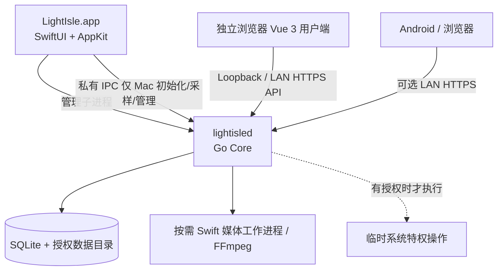

# macOS 单体应用形态与进程生命周期

> **当前已实施的产品原则：启动 LightIsle.app 就启动 NAS；完全退出 App 就关闭 NAS。**
>
> NAS 服务端与原生管理端仅支持 macOS arm64；浏览器和 Flutter Android/iOS/macOS 是独立用户客户端。Mac App 打开时启动 Go Core、关闭窗口保留菜单栏继续提供 NAS，**只有 ⌘Q/菜单退出才停止 Core**。已有代码与打包模拟测试不能代替真实 GUI、睡眠/唤醒及系统注销验收；不提供独立 NAS 守护服务。

## 1. 产品形态

LightIsle 是完整的 SwiftUI/AppKit macOS 原生**管理端**（Dock 图标、主窗口、系统状态、菜单、设置）。用户打开 `LightIsle.app` 后启动内嵌 Go Core；Mac 只管理首次管理员初始化、系统状态、服务与共享目录。**文件、图库、影视和后续账号管理属于单独的 Vue Web 用户端**，由用户通过浏览器打开，Mac 不内嵌 Web 用户页面。

**统一设计要求**：Mac 原生控制台和独立 Vue Web 用户端遵循 [iOS 27 / macOS 27 视觉规范](DESIGN_SYSTEM.md)，按不同终端交互习惯实现。Mac 不启动 WKWebView，有利于降低常驻内存和多套导航维护成本。

**不安装、也不单独启动长期驻留的 Go NAS 守护进程。**

## 2. 生命周期（强制）

| 动作 | macOS App | Go Core | Android / Web |
| --- | --- | --- | --- |
| 打开 LightIsle.app | 启动主窗口 | 自动启动子进程 | 远程访问开启后可连接 |
| 最小化窗口（⌘M） | 继续运行 | 继续运行 | 保持连接 |
| 关闭最后一个窗口 | **保留菜单栏，管理窗口可重新打开** | **继续运行** | 保持连接 |
| ⌘Q / 菜单退出 | 完全退出 | **优雅关闭并退出** | 连接断开 |
| 强制退出 / App 崩溃 | 异常结束 | 通过父进程检测自行关闭 | 断开 |
| Go Core 崩溃 | 显示故障及重启操作 | 已退出，禁止孤儿 Worker | 断开 |
| macOS 用户注销 | 退出 | 退出 | 不可连接 |
| App 未打开、Mac 未登录 | 不运行 | **不运行** | **不可连接** |

用户最小化或关闭窗口不等于退出 App；服务仍在当前用户登录会话中运行。登录项是 **SMAppService.mainApp** 注册同一个 App（非 Go 守护进程）；空闲睡眠抑制仅在用户启用且 Core 在线时持有。系统主动睡眠、用户注销、FileVault 重启未解锁或断电后**不保证 NAS 在线**。不提供“App 已退出、NAS 继续运行”选项。

### 轻量模式（2026-10-27）

- 已增加「偏好与安全 → 通用 → 轻量模式」和菜单栏入口。手动进入后卸载原生管理页的 SwiftUI 视图树、释放页面级状态和监控图表/历史缓存，并关闭主窗口、暂时隐藏 Dock 图标；菜单栏的叶子图标显示当前轻量状态，选择「恢复正常管理界面」重新创建页面并恢复 Dock 图标。
- 正常模式每 3 秒查询一次 UI 状态；轻量模式每 60 秒只查询必要的 Core 告警/共享状态，**不停止 Go Core**。文件上传、后台任务、远程 API 和系统防空闲睡眠设置都沿用正常服务生命周期，退出 App 仍关闭 Core。轻量模式会减少管理端内存占用，但内存回收的具体幅度取决于系统；不承诺释放 Go Core 或系统页面缓存。
- 已运行的 App 收到 macOS 锁屏通知时默认自动进入轻量模式；在通用设置中可关闭自动切换，仍允许手动进入。屏幕解锁**不会**自动打开管理窗口，以免打断工作。自动触发与现有「登录 Mac 时自动打开轻屿」相互独立：如果 App 已完全退出或 Mac 尚未登录，锁屏本身无法启动应用或提供 NAS。
- 本功能需要真实 macOS 锁屏/解锁、菜单栏重开、连续服务、睡眠/唤醒以及内存采样的设备验收；编译和单元测试并不证明系统锁屏通知在所有 macOS 版本中都能触发。

## 3. 组件与依赖

- `LightIsle.app` 是生命周期唯一所有者。Swift 使用 `Process` / `NSTask` 管理 Go 子进程，不使用独立的 `launchd` 守护服务；可由用户通过 `SMAppService.mainApp` 注册 App 本身作为登录项（与后台 helper/daemon 不同）。
- Go Core 负责 API、SQLite、文件索引、图库、影视、系统状态。媒体 Worker 和 FFmpeg 由 Go 管理，工作完成或 App 退出时全部释放。
- SwiftUI 处理首次管理员初始化、系统授权、服务启停、错误诊断与本机 CPU/内存/磁盘信息；Go 提供私有进程控制消息，不公开 HTTP 首任管理员注册入口。
- Vue 3 只在浏览器承担文件/图库/影视等用户业务、登录和管理员后续账号维护。Mac 使用原生材质和布局，不嵌入 WKWebView。
- 默认只在 `127.0.0.1` 提供本机 API；首次启用远程访问须用户显式授权，启用 HTTPS 与账号密码登录，无需设备扫码配对。不开放公网管理端口。
- Docker/Colima 属外部可选服务。App 退出时仅停止 LightIsle 的监控、任务和会话，**不擅自结束用户正在运行的第三方 Docker 容器/虚拟机**。
- 危险操作仅通过用户明确授权的临时操作执行，不提供持久 root 守护进程或任意命令 Web API。

### 原生协调器与进程私有 IPC（已落地）

为降低 `AppModel.swift` 对平台副作用与协议实现的直接耦合，原生管理端目前将相关职责独立在：

- `NativeAlertCoordinator.swift`：映射 Core 持久化告警、去重与本地通知；原生通知仍须用户授权。
- `NativeServicePresenceCoordinator.swift`：仅在 Core 在线且用户主动启用时抑制空闲睡眠；只对当前 HTTP/HTTPS 局域网监听进行 Bonjour 广播，TXT scheme 表明真实协议，**不新建监听端口**。
- `TunnelWireCodec.swift`：隧道命令操作白名单、有界 IPC JSON/Base64URL 编解码；`TunnelPayloadParser.swift`：将响应映射为账号、区域、隧道与 Ingress 的类型化数据。
- `TunnelCredentialCoordinator.swift`：配置前暂存 Token，收到 Core 明确验证的 `configure` 响应后才写钥匙串；写入失败保留原凭据并提示错误；Core 重启后通过钥匙串重新验证。
- `RootManagement.swift` 和 `RootManagementView.swift`：家庭版仅添加、重连或移除额外存储根。已删除逐根计划备份 IPC、备份状态轮询与旧单根迁移预检；不触碰硬盘原始文件。

原有 `AppModel` 仍负责 SwiftUI 可观察状态和调用上述协调器；这些抽取不是将服务管理移到浏览器，也不允许普通 HTTP 客户端触发系统 IPC。对应可执行回归检查位于 `tests/NativeServicePresenceCheck.swift`、`tests/TunnelWireCodecCheck.swift`、`tests/TunnelPayloadParserCheck.swift`、`tests/TunnelCredentialCoordinatorCheck.swift`，统一纳入 `scripts/verify-macos.sh`。钥匙串授权、实际网络、通知送达和休眠/唤醒行为仍须 Mac 真机人工验收。

## 4. 正常退出流程

1. SwiftUI 将 App 标记为 stopping，阻止提交新任务。
2. SwiftUI 通过私有 IPC 发出 `shutdown`；Go 关闭监听端口、主动断开 Android 客户端。
3. Go 取消/暂停索引、上传、转码、备份任务，保存可恢复检查点并等待活动文件写入安全结束；关闭数据库、子进程和文件句柄。
4. SwiftUI 设置退出超时，超时后依次 `SIGTERM`、`SIGKILL` 清理 Go 子进程并记录异常原因。
5. 原生应用退出。下一次打开时自动恢复可恢复的任务、重建媒体缓存，而不是继续运行旧后台。

### App 崩溃后的清理

macOS 不保证父进程崩溃就会自动杀掉子进程，因此同时设计：

- 父进程专用 IPC pipe：App 保持写端，Go 监听 EOF，出现 EOF 则关闭服务。
- Go 定期检查父进程 PID/身份与 heartbeat，防止异常管道继承引起永久存活。
- Go 管理的媒体子进程同样实现停机与超时。
- 异常 kill、断电时不能保证完全优雅，文件写入和 SQLite 任务必须支持恢复。
- 再次启动前检查单实例锁与现有进程身份，避免误杀与重复启动。

## 5. 包装交付

最终交付唯一的 `LightIsle.app`（可放入 DMG），包含：

- SwiftUI 主应用、可用的本地设置与故障页面。
- 已签名的 macOS arm64 Go 可执行文件。
- 内嵌静态 Vue 3 资源。
- 按需的 Swift 媒体 Worker；**FFmpeg 为用户独立安装的可选外部程序**，LightIsle 不自动下载或捆绑 ffmpeg 可执行文件。未安装时原片直放/下载应继续可用。

具体嵌入路径、沙箱策略、签名和公证需在 Xcode 的 Apple Silicon 真机上验证。**不用系统守护服务和开机自启代替 App 生命周期。**

## 6. 生命周期与原生交互验收

- [ ] 双击 App 自动启动 Go API，不需要运行终端命令。
- [ ] App 内能查看真实 Mac CPU、内存、存储状态。
- [ ] Android 在用户显式开启远程访问后可以连接；App 退出后立即失效。
- [ ] 最小化/关闭最后一个窗口继续提供服务；从菜单栏恢复主窗口；按 ⌘Q/菜单退出后 Go 在规定时间内结束（需要真实 GUI 验收）。
- [ ] 强制杀掉 App 后，Go 通过 pipe EOF/父进程身份检查结束，不留常驻 NAS API。
- [ ] Go 崩溃时 SwiftUI 界面仍能显示错误并尝试修复。
- [ ] 再次打开 App 不出现重复端口监听或失控任务。
- [ ] Apple Silicon 真实测量 App + Go + 浏览器用户端（分别记录） 的内存开销，不能只测 Go。
- [ ] 原生窗口与独立 Web 的深/浅色、导航和玻璃材质风格一致，并通过减少透明度与减少动态效果测试。

相关文档：[README](../README.md)、[设计系统](DESIGN_SYSTEM.md)、[架构](ARCHITECTURE.md)、[路线图](ROADMAP.md)、[性能](PERFORMANCE.md)、[安全](SECURITY.md)。

