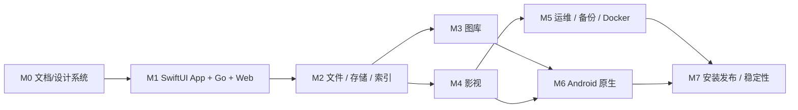

# 开发推进路线图

> 状态基线：**M1–M5 开发预览**。Mac App 负责初始化、监控、服务/存储及本机备份恢复；文件、图库、影视继续由独立 Web 用户端实现。M5 已加入手动文件备份/安全恢复、SMB 只读端口诊断；SMB 管理、自动备份和特权操作尚未完成。后端仅 macOS arm64；Flutter 暂定 Android。
>
> 不按任意承诺日期排期，采取阶段门禁：上一阶段基础质量达标才扩展下一阶段。

> 2026-10-20 P0 增补：目录级成员授权、有限搜索/同共享卷复制移动、网络速率及挂载卷清单、备份 v2 SQLite 一致性快照、FSEvents + 周期对账与扫描任务取消均已有代码。本路线图中未划掉的任务仍表示**未达到完整验收**；参见 [P0 范围与剩余门槛](P0_IMPLEMENTATION_STATUS.md)。

## 1. 阶段依赖

## 2. 阶段计划

| 阶段 | 状态 | 交付 | 验收门槛 |
| --- | --- | --- | --- |
| **M0** 产品与工程设计 | 已完成首版 | README、范围、架构、Mac App 生命周期、iOS 27 风格设计系统、开发与安全性能规范 | 文档互链无误，平台范围与退出行为统一，设计 token 方案明确 |
| **M1** 原生 Mac App 基础控制台 | **开发中（初版已编译）** | SwiftUI LightIsle.app（Go 子进程管理）、Vue/PWA、SQLite、管理员、安全 API、CPU/内存/磁盘、主题与首批跨端组件 | 双击 App 自动启动 Go；Mac 原生窗口可看指标；用户开启远程连接后 Android 浏览器可查看；关闭 App 后 API/Go 退出、Android 断开；浅/深色与低透明模式通过检查 |
| **M2** 文件与存储 | 开发中 | 授权根目录、目录分页、上传续传、预览、回收站，跨卷任务待做 | 5GB 文件续传可校验；移动后索引正确；拔盘重连不误删除；非法路径访问被拒绝 |
| **M3** 图库 | 开发中 | SQLite 索引、JPEG/TIFF EXIF、时间线、相册、收藏、按需 sips 缩略图已开发；完整 HEIC 元数据/视频海报待开发 | 1 万张素材首次扫描/暂停/恢复均可完成；Web 虚拟滚动不一次加载全部；原文件不修改 |
| **M4** 影视 | 开发中 | 电影/剧集与搜索、Web 影视墙、同目录字幕、按账号续播、Range 原片直放已实现初版；海报/元数据刮削及 VideoToolbox 按需转码待开发 | Android 浏览器可播放至少一种直放样本；不兼容时有说明或转码；停止播放后无孤儿转码进程 |
| **M5** NAS 运维 | 开发中 | Mac 私有 IPC 手动/每日/每周全量共享文件备份、SHA-256 校验与独立目录恢复、SMB TCP 445 只读诊断；系统特权 Helper、SMB 配置及可选 Docker 管理待开发 | 备份/恢复安全测试与应用打包通过；远程 Web 无法越权触发；真实外置盘与大数据量验证仍待完成 |
| **M6** Flutter Android | 未开始 | Android 原生连接、文件/图库/影视、通知、后台照片同步、共享 iOS 27 视觉语义 | 断网可重试且不重复上传；与 Web 和 Mac 的主题/组件风格一致；遵守 Android 系统返回/权限规范 |
| **M7** 发布与稳定 | 未开始 | 单一 LightIsle.app、签名/公证、升级回滚、日志与故障恢复、Android 发布准备、三端视觉回归 | 干净机器安装；App 完全退出后无 NAS 进程；迁移/回滚演练；App 运行状态下 72 小时稳定性实测 |

验收中的 5GB、1 万张、72 小时是**计划测试规模**，并非宣称当前性能。

## 3. M1 最小可执行任务列表

- [x] SwiftUI Mac App / Go Core / Vue 3 项目骨架创建并通过编译；初版 .app 成功打包。
- [x] macOS Mach API CPU、内存、系统卷指标的只读采集，API 测试通过。
- [x] Web 响应式 iOS 风格首页和设计 token 浅/深色主题。
- [x] 通过实际打包 Go Core 验证父进程管道 EOF 关闭、服务端口释放。
- [ ] 完成 App GUI 级启动、⌘Q、关窗、崩溃退出验收。
- [ ] 完成账号认证、SQLite、远程 TLS/设备配对后再开放 Android。
- [ ] 确定最低 macOS 版本、Go/Swift/Node/Flutter 版本支持矩阵；确认 Apple Silicon 测试机。
- [ ] 初始化 SwiftUI LightIsle.app 原生窗口，内嵌并监督 macOS arm64 Go 子进程；实现启动、关闭、崩溃后清理。
- [ ] 初始化 Go 模块、chi、配置加载、统一错误格式、`GET /api/v1/health`。
- [ ] SQLite 建表与迁移、备份策略、认证/会话模型、审计表。
- [ ] macOS ARM64 指标采集：CPU、内存、网络、磁盘总量/剩余空间。
- [ ] Vue 3 响应式首页：首次初始化、登录、仪表盘、设备指标；Android 竖屏验收。
- [ ] 建立 iOS 27 风格的统一语义 Design Tokens、SwiftUI + Vue 主题映射、浅/深/减弱透明度三种视觉模式。
- [ ] 完成 Mac 原生主窗口、工具栏、服务状态和 WKWebView 内嵌界面的导航一致性。
- [ ] 生成 OpenAPI/TypeScript SDK；API 权限拒绝、输入验证和错误路径单元测试。
- [ ] Mac App 启停 Go 子进程、退出清理与异常父进程存活检测；日志写入及故障恢复。
- [ ] 关闭 App/强制退出 App 后，确认 Go 和媒体 Worker 不残留；Android 连接中断。
- [ ] 基准脚本：冷启动、空闲 RSS、CPU、请求延迟、磁盘扫描受控测试。
- [ ] 技术 ADR：媒体 Worker 使用 IPC 的初始协议和安全权限边界。

## 4. 后续分阶段待办

### M2 文件与索引

- [ ] 文件根目录注册、卷身份、路径穿越/符号链接防护。
- [ ] 目录分页、搜索、文件 CRUD、回收站、上传续传、Range 下载。
- [ ] FSEvents 监听 + 周期对账 + 盘离线状态；队列可取消、重试和限流。
- [ ] 大文件流式操作、跨卷复制校验、失败回滚。

### M3 图库

- [ ] 从 file_entries 派生图库资产、照片时间线、相册/收藏模型。
- [ ] ImageIO/QuickLook 缩略图服务、格式支持矩阵、缓存上限。
- [ ] EXIF/HEIC/方向旋转/损坏文件测试。
- [ ] Android 浏览器列表虚拟化、触摸手势和视频混排。

### M4 影视

- [x] 影视文件名识别、管理员手动编辑影片显示标题与 SQLite 影片索引（ffprobe/AVFoundation 探测待做）。
- [x] 原文件 MP4/WebM 直放和 HTTP Range；同名 SRT/VTT 字幕（复杂编码兼容性待做）。
- [ ] FFmpeg VideoToolbox 转码的超时、并发、缓存清理、兼容性矩阵。
- [x] 每账号观看进度持久化、继续播放以及格式不支持时提示下载原片（空间不足提示待做）。

### M5 运维

- [ ] Swift Helper 的最小特权 RPC、安装审批与权限撤销。
- [x] SMB 445 端口探测（只读）和跳转 macOS 共享设置；SMB 启停配置与受控关机重启仍待做。
- [x] Mac 私有 IPC 手动共享文件备份，SHA-256 校验清单与恢复到独立目录（不覆盖原文件）。
- [x] 可选每日/每周全量备份（仅 Mac App 运行时运行），计划本机持久化和取消。
- [ ] 自动备份轮换、应用账号/SQLite 安全备份与完整灾难恢复演练。
- [ ] Docker API / Colima 插件可选启用，离线状态不能拖慢核心启动。

### M6 Android

- [ ] Flutter Android 工程、扫码或码配对、TLS/设备身份。
- [ ] 核心文件、图库、影视原生体验与后台照片备份队列。
- [ ] Android 权限、后台限制、漫游网络和电池优化下测试。
- [ ] 复用同一套语义 design token 和组件状态，测试 iOS 27 风格下的 Android 返回手势和低性能设备降级。

### M7 发布

- [ ] 版本化 SQLite migration 和回滚策略。
- [ ] 适配 macOS arm64 的单一 LightIsle.app、签名/公证构建、升级与卸载；不得创建独立常驻 NAS 守护服务。
- [ ] Mac App 打开状态下 72 小时稳定性与多样本播放测试；备份演练。
- [ ] Mac / Web / Android 深浅色、减少透明度、减少动效、导航与关键流程的视觉回归和性能验证。
- [ ] 版本发布说明、第三方许可核查、用户安装文档。

## 5. 每项功能的 DoD（完成定义）

1. 实际代码 + API + 用户入口到位，并记录支持范围及 macOS 版本。
2. 权限校验、错误提示、日志与危险操作限制完备。
3. 单测/集成测覆盖基本和错误场景；手机端实际操作测试。
4. 对扫描/上传/备份/转码：取消、重试、重启恢复、盘离线均有验证。
5. 核心空闲资源占用满足既定目标或记录并解释偏差。
6. README 状态、功能矩阵、文档与版本日志同步更新。

## 6. 主要风险及决策

| 风险 | 应对 |
| --- | --- |
| macOS 高权限服务审批复杂 | M1 只读，M5 前设计有限 RPC；禁止任意命令执行 |
| 系统盘/外置盘误操作 | 根目录白名单、卷身份验证、系统盘禁抹除 |
| FSEvents 可能丢失或合并事件 | 重启/定期对账，离线卷状态单独处理 |
| SQLite 写负载与大媒体库 | 单写者、批处理、FTS5；真实样本压测 |
| Web 浏览器解码能力不同 | 测试矩阵、直放优先、按需转码 |
| Colima 生命周期与开机自启 | Docker 明确设为可选功能、依赖独立健康检查 |
| FileVault/无人值守重启 | 真实机器测试并在 UI 标注实际能力 |
| App 退出后的子进程孤儿化 | pipe EOF、父进程心跳、故障注入、进程与端口回收验收 |
| 全端玻璃效果导致掉帧/高内存 | 仅导航/控制层使用材质，内容区尽量不模糊，提供不透明降级与性能门禁 |
| 平台扩张影响开发效率 | 后端保持 **macOS arm64-only**；不为其他后端设计抽象兼容层 |

## 7. 首轮决策点（开始编码前）

- [ ] 最低 macOS 版本和软件开发工具版本。
- [ ] SwiftUI App 与 Go Core 的子进程 IPC/退出协议、打包位置与崩溃恢复策略。
- [ ] iOS 27 风格共享设计 token 的首版定义及视觉验收样张。
- [ ] 默认授权数据目录、SQLite 数据库和缩略图缓存放在哪里。
- [ ] 本地账号与设备配对形式，LAN 默认监听策略。
- [ ] 最小 Swift Helper API 范围及安装签名路径。
- [ ] 开源许可证、品牌名和仓库正式命名。

参阅 [架构](ARCHITECTURE.md) · [开发指南](DEVELOPMENT.md) · [性能](PERFORMANCE.md) · [安全](SECURITY.md)。
